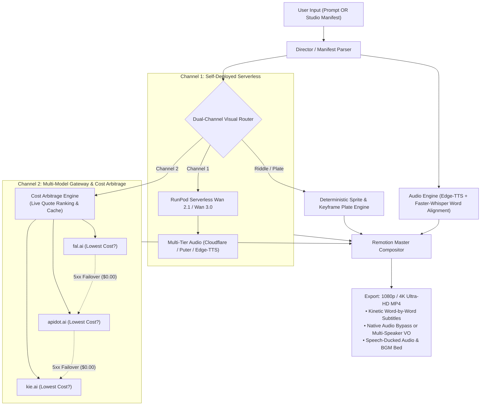

# Universal AI Video Production Studio

> **High-Performance Multi-Genre Vertical Video Generation Pipeline**  
> Covers **Interactive Riddles**, **Cinematic Stories/Cartoons**, and **Action Sequences** with **Zero "Reroll Tax"**, **Tail-to-Head Frame Chaining**, and **Remotion Master Compositing**.

---

## 🚀 Key Features

1. **Dual Ingestion Modes**:
   - **Autonomous Director Mode**: Provide a 1-sentence prompt and the AI deconstructs it into multi-beat scenes, synthesizes voiceover, and compiles the video.
   - **Directed Studio Mode**: Bring your own pre-written script and reference images (character art, background plates) for full creative direction with 100% style locking.
2. **Dynamic AI Story Writer & Multi-Tier Cascade**:
   - Automatically expands creative concepts into rich multi-scene cinematic narratives with custom dialogue, camera motion, and audio cues.
   - Ingests long-form scripts or articles (`--input-mode script_adaptation`) while preserving 100% of the author's original dialogue.
   - Resilient multi-tier model cascade (`gemini-3.8-flash`/`pro` ➔ `gpt-4o` ➔ `gemini-1.5-flash` ➔ offline rule engine fallback with zero crashes; transparent forward aliasing for `gemini-2.5-flash` and `gemini-2.0-flash`).
3. **Multi-Character Spoken Dialogue Attribution**:
   - Automatically parses distinct speaking characters (e.g. `[Daisy]`, `[Barnaby]`, `[Narrator]`) and assigns distinct neural voice personas (`cartoon_animal`, `male_casual`, `female_sarcastic`, `deep_villain`, `kid`).
   - Synthesizes per-scene dialogue audio and stitches tracks into a master composite with global word-level kinetic subtitle alignment.
4. **Continuous Video Motion Diffusion (Zero Strobe / Shutter)**:
   - Eliminates 16 fps strobe flickering by switching ComfyUI workflows to native 3D temporal video latents (`EmptyHunyuanLatentVideo`) conditioned on approved keyframe images.
   - Authors diffusion prompts using the **4-Part Kinetic Formula** (Subject Action + Secondary Interaction + Environmental Physics + Camera Kinetics).
   - Dynamically calculates safe $4k+1$ frame counts (17, 33, 49, 65, 81 frames) with PTS duration scaling to eliminate frozen terminal frames.
5. **Multi-Aspect Ratio Canvas Framing**:
   - Native video compilation and aspect-aware visual prompt tailoring for `9:16` (Shorts/TikTok/Reels), `16:9` (YouTube/Desktop), `1:1` (Instagram Square), and `4:5` (Social Portrait) with 0% distortion or pillarboxing.
6. **The 3 Anti-Reroll Strategies**:
   - **Strategy 1 (Programmatic Hybrid)**: 100% deterministic, $0.00 compute for riddles, countdown timers, and clean sprite transformations.
   - **Strategy 2 (Dual-Frame Interpolation)**: 85%–90% first-pass accuracy for physical state changes.
   - **Strategy 3 (Unmetered Flat-Rate GPU)**: Unlimited free rerolls for cinematic story acting and combat action via RunPod ComfyUI (RTX 4090 @ $0.44/hr).
7. **Tail-to-Head Frame Chaining**:
   - The final frame ($t = \text{end}$) of Clip $K$ is automatically fed as Frame 0 into Clip $K+1$, eliminating jump cuts and preserving physical continuity.
8. **Remotion Master Compositor**:
   - Word-by-word kinetic animated subtitles synchronized to Whisper speech timestamps.
   - SVG radial countdown dials with audible tick sounds.
   - Speech-aware automatic audio ducking for background music.
9. **Dual-Channel Video Rendering & Dynamic Cost Arbitrage**:
   - **Channel 1 (Self-Deployed Serverless)**: RunPod Wan 2.1 / Wan 3.0 serverless worker with multi-tier audio synthesis (Cloudflare, Puter, Edge-TTS).
   - **Channel 2 (Multi-Model Provider Gateway)**: Real-time price quotation and ranking across `fal.ai`, `apidot.ai`, and `kie.ai`. The system automatically routes jobs to whichever provider delivers the lowest cost for the chosen model (Kling, Seedance, Runway, MiniMax, Wan, CogVideoX).
10. **Zero-Cost Failure Insurance**:
   - All provider adapters enforce a zero-cost guarantee: 5xx server errors, queue timeouts, and worker crashes cost strictly $0.00 before gracefully cascading to the next verified provider.
11. **Render-Time Prompt Compilation & Pure-Motion I2V**:
   - **Decoupled Story Generation**: Storywriter produces pure narrative scripts without truncating to any single video model budget prematurely.
   - **Late-Stage Prompt Compilation (`PromptCompiler`)**: Dynamically compiles final render prompts at dispatch time using model-specific character limits, target audio syntax, and pure-motion kinetic transforms for Image-to-Video (stripping static visual descriptions while preserving character actions).
   - **Context-Aware Dynamic Negative Prompting (`NegativePromptCompiler`)**: Style-calibrated negative prompts ensure live-action photorealistic renders never include contradictory tags like `"realistic photography"`.
12. **Native Video Audio Integration & Collision-Free Remotion Mix**:
   - Injects model-specific audio tags (`<d>...</d>` for MiniMax, spoken cues for Kling/Seedance/Veo, native flags for Wan 3.0) when native audio is selected.
   - When a clip contains native audio (`hasClipAudio: true`), Remotion un-mutes the video track (`volume={1.0}`), mutes overlapping synthetic voiceover (`volume={0.0}`), and ducks BGM to an ambient bed (0.08) to eliminate double-talking.
13. **Incremental Video Extending & 4K Super-Resolution**:
   - Incremental +4s/+5s video clip extension billed only for the added seconds.
   - 4K Ultra-HD super-resolution upscaling via Topaz Video AI or Real-ESRGAN/Lanczos neural plate pipeline.

---

## 🛠️ Architecture Overview



---

## 📦 Quickstart & Usage

### 1. Installation
```bash
# Activate Python virtual environment and install dependencies
source .venv/bin/activate
uv pip install -r requirements.txt

# Install Remotion dependencies
cd remotion
npm install
cd ..

# Install Web Studio frontend dependencies
cd studio
npm install
cd ..
```

### 2. Launch Localhost Web Studio Interface (FastAPI + React 18)
```bash
# Launch both FastAPI backend and Vite frontend with a single command:
python -m core.cli studio

# Or launch backend only (serves built React production SPA at http://localhost:8000):
python -m core.cli studio --no-frontend
```
Open **`http://localhost:5173`** (or `http://localhost:8000`) in your browser to access:
- **Visual Storyboard Canvas**: Review cards, edit prompts, re-roll single scenes, switch between `16:9` and `9:16`.
- **Gemini AI Director Copilot**: Chat in real-time (*"Make beat 2 darker and add rain"*) to surgically update cards.
- **Embedded Remotion Player**: 60 FPS in-browser scrubbing with kinetic subtitles and audio ducking.
- **RunPod Serverless Grid**: Live GPU worker tiles, elapsed compute timer, and real-time USD billing counter.

### 3. Interactive Director Engine (Review, Modify & Approval Gate via CLI)
```bash
# 1. Plan and review complete storyboard with generated keyframes (Halts at approval gate)
python -m core.cli direct --prompt "A brave astronaut discovering an ancient crystal on Mars"

# 2. Conversational delta modifications in terminal REPL:
#    > modify 2 make the crystal glowing purple and remove the voiceover
#    > approve

# 3. Dynamic Narrative Expansion with Aspect Ratio (16:9 Landscape YouTube):
python -m core.cli direct \
  --prompt "A space freighter docking at an orbital station over Saturn rings" \
  --aspect-ratio 16:9 \
  --auto-approve \
  --output outputs/saturn_docking_16_9.mp4

# 4. Long-Form Script Ingestion with 100% Spoken Dialogue Preservation:
python -m core.cli direct \
  --prompt scripts/solar_flare.txt \
  --input-mode script_adaptation \
  --aspect-ratio 9:16 \
  --auto-approve \
  --output outputs/solar_flare_vertical.mp4

# 5. Frontier LLM Cascade Override:
python -m core.cli direct \
  --prompt "Cyberpunk motorcycle chase through Neo-Kyoto alleys" \
  --model gemini-3.8-flash \
  --aspect-ratio 16:9 \
  --auto-approve

# 6. Multi-modal character/environment reference binding with auto-approve:
python -m core.cli direct \
  --prompt "Detective Ren corners an android in the rain. Action strike then arrest." \
  --character "detective_ren:assets/detective_scene1.jpg" \
  --auto-approve \
  --output outputs/detective_action.mp4
```

### 3. Generate an Autonomous Video (Direct Render)
```bash
python -m core.cli render \
  --prompt "A clever cyber detective uncovers a secret data core in the rain" \
  --genre cinematic_story \
  --output outputs/cyber_detective.mp4
```

### 4. Generate a Deterministic Riddle Video (Zero Hallucination)
```bash
python -m core.cli render \
  --manifest specs/001-universal-video-pipeline/examples/riddle_manifest.json \
  --output outputs/six_glasses_riddle.mp4
```

### 5. Generate an Action Video with Tail-to-Head Frame Chaining
```bash
python -m core.cli render \
  --manifest specs/001-universal-video-pipeline/examples/action_manifest.json \
  --output outputs/samurai_action.mp4
```

### 6. Check Cloud GPU Health & Specs (RunPod / ComfyUI)
```bash
python -m core.cli health
```
*Outputs real-time latency, GPU hardware (e.g. RTX 4090), VRAM stats, and loaded models (Wan 3.0 / Wan 2.1).*

### 7. Live Interactive Remotion Studio (Browser Preview)
```bash
cd remotion
npm run start
```
*Opens interactive video scrubber at `http://localhost:3000`.*

---

## 🎨 Zero-GPU Local Visual Mock & Ken Burns Camera

When running locally without a GPU pod, the studio automatically:
1. **Generates HD Scene Keyframes**: Synthesizes high-definition stylized visual backgrounds for each beat using local prompt hashing and file caching in `outputs/temp/`.
2. **Ken Burns 2.5D Camera**: Seamlessly animates static plates with continuous camera push-in scaling (`1.0x` ➔ `1.14x`) and diagonal panning in Remotion.
3. **Procedural Riddle Puzzle Plates**: Renders pixel-perfect 6-glasses puzzle graphics and radial countdown timers with 0% counting hallucination.

---

## ⚡ RunPod Serverless Parallel Video Pipeline (10x Speedup)

To eliminate the single-pod sequential rendering bottleneck (~40 minutes for 4 narrative beats down to under **3 minutes**), the studio supports **RunPod Serverless** parallel multi-beat diffusion.

### 1. Configuration
Add the following to your `.env` file:
```bash
# RunPod Serverless API Credentials
RUNPOD_API_KEY="your-runpod-api-key"
RUNPOD_SERVERLESS_ENDPOINT_ID="your-endpoint-id"     # e.g., v2-abc123xyz
MAX_SERVERLESS_CONCURRENCY=4                        # Max concurrent worker GPUs (default 4)
```

### 2. Multi-Backend Routing (`--backend`)
Choose your visual diffusion backend on any CLI command:
```bash
# Auto mode (Default: Serverless -> Pod -> Local Mock cascade)
python -m core.cli direct --prompt "Cyberpunk city in neon rain" --backend auto

# Force Serverless parallel execution (<3 min turnaround)
python -m core.cli direct --prompt "Cyberpunk city in neon rain" --backend serverless

# Use dedicated RunPod ComfyUI pod ($0.44/hr unmetered)
python -m core.cli direct --prompt "Cyberpunk city in neon rain" --backend pod

# Zero-GPU local mock with 2.5D Ken Burns camera ($0.00 compute)
python -m core.cli direct --prompt "Cyberpunk city in neon rain" --backend local
```

### 3. Key Capabilities
- **Parallel Multi-Beat Dispatch**: Dispatches all storyboard narrative beats concurrently across independent cloud GPUs with `asyncio.Semaphore` rate limiting.
- **Resilient 3-Tier Failover Cascade**: If serverless encounters cold starts, capacity spikes, or missing credentials, generation automatically falls back to dedicated pod, and finally to local mock without crashing.
- **Safe Cloud Cancellation**: Intercepts `Ctrl+C` (SIGINT) to immediately issue batch `/cancel` commands across all in-flight worker job IDs, preventing orphaned billing.
- **Live Billing Transparency Banner**: Outputs exact cumulative GPU compute seconds and USD cost (e.g., ~$0.063 per 4-beat video at $0.00021/sec on RTX 4090).

---

## 🧠 Wan 3.0 Omni-Reference ComfyUI Integration

The studio includes a validated ComfyUI workflow recipe for **Wan 3.0** (`core/workflows/wan3_omni_reference.json`):
- **Up to 10 Reference Images**: Maps character face, costume, environment, and anchor frames using Omni-Reference latent conditioning.
- **Continuous Generation**: Supports single-pass video generation from 2 up to 30 seconds (900 frames).
- **RunPod Flat-Rate Deployment**: Connect your unmetered RunPod RTX 4090 pod by exporting:
  ```bash
  export RUNPOD_COMFY_URL="https://<your-pod-id>-8188.proxy.runpod.net"
  ```

---

## 🧪 Running Tests

```bash
# Run all unit and integration tests
.venv/bin/pytest tests/
```

---

## 📄 License
MIT License. Open source and self-hosted.


---

## 📁 Repository Structure

```text
ai-text-to-video/
├── core/                        # Python Orchestration Core
│   ├── models.py                # Pydantic v2 domain schemas
│   ├── director.py              # LLM storyboard generator & intent classifier
│   ├── manifest_parser.py       # Directed Studio manifest validator
│   ├── audio_engine.py          # Edge-TTS voice synthesis & Whisper timestamps
│   ├── sfx_mixer.py             # SFX library & dynamic volume ducking
│   ├── visual_router.py         # Tri-Strategy Anti-Reroll dispatcher
│   ├── chain_manager.py         # Tail-to-Head frame extractor (Frame -1 ➔ Frame 0)
│   ├── runpod_client.py         # RunPod ComfyUI REST/WebSocket client
│   ├── remotion_bridge.py       # Remotion props builder and render bridge
│   ├── cache.py                 # Temporary artifact manager
│   ├── pipeline.py              # Pipeline execution core
│   └── cli.py                   # Unified CLI runner
├── remotion/                    # Master React Video Compositor
│   ├── src/
│   │   ├── Root.tsx             # Remotion composition registration
│   │   ├── Composition.tsx      # Main timeline sequencer
│   │   ├── components/          # Kinetic subtitles, countdown dial, audio mixer
│   │   └── templates/           # Riddle, Story, and Action templates
│   └── package.json
├── assets/                      # Curated asset library
│   ├── audio/sfx/               # Sound effects (ticks, whooshes, chimes, pours)
│   ├── audio/music/             # Ambient background music
│   └── processed/               # Clean transparent sprites & solved plates
├── specs/                       # SpecKit specifications, contracts, and tasks
└── tests/                       # Unit and integration test suites
```
