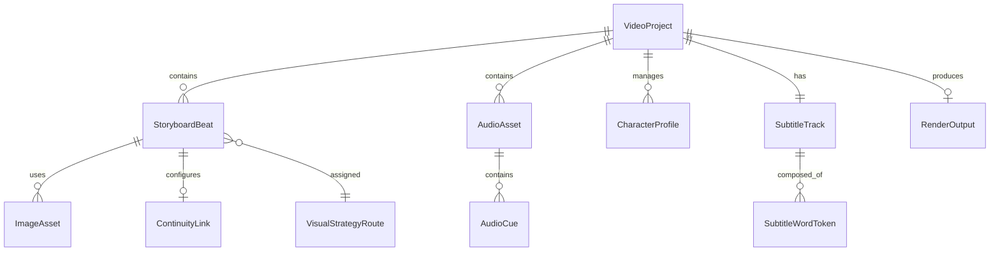

# Phase 1 Data Model: Universal Multi-Genre Video Generation Pipeline

**Feature Branch**: `001-universal-video-pipeline`  
**Date**: 2026-10-23  
**Status**: Completed  

---

## 1. Entity Relationship Diagram

---

## 2. Entities Specification

### 2.1 VideoProject (Root Entity)
Represents a single end-to-end video production run.

| Field | Type | Validation / Description |
| :--- | :--- | :--- |
| `id` | `string` (UUIDv4) | Unique project identifier |
| `title` | `string` (1–100 chars) | User-facing video title |
| `genre` | `enum` | `'riddle'`, `'cinematic_story'`, `'action'` |
| `ingestion_mode` | `enum` | `'autonomous_director'`, `'directed_studio'` |
| `aspect_ratio` | `string` | Default `'9:16'` (1080x1920) |
| `fps` | `integer` | Default `30` (or `60`) |
| `total_duration_sec` | `float` | Target duration: between 20.0s and 60.0s |
| `created_at` | `datetime` | Creation timestamp |
| `status` | `enum` | `'draft'`, `'storyboarding'`, `'generating_audio'`, `'generating_visuals'`, `'compositing'`, `'completed'`, `'failed'` |

---

### 2.2 VisualStrategyRoute (Enum)
The core anti-reroll execution routing strategy assigned to each shot.

- **`PROGRAMMATIC_HYBRID`**: 100% deterministic Remotion sprite/plate composition ($0.00 cost, zero hallucination). Used for riddles, static setups, countdown timers.
- **`START_END_INTERPOLATION`**: Dual-frame guided diffusion (85%–90% first-try success). Used for verified physical state transformations (e.g. Glass 2 water entering Glass 5).
- **`FLAT_RATE_DIFFUSION`**: Remote unmetered GPU video generation (RTX 4090 @ $0.44/hr via ComfyUI). Used for cinematic story acting, character dialogue, and high-octane action shots.

---

### 2.3 ImageAsset (Typed Operational Role)
Visual input or generated frame tagged with one of 6 operational functions.

| Field | Type | Validation / Description |
| :--- | :--- | :--- |
| `id` | `string` | Image asset identifier |
| `file_path` | `string` | Local path or URI to the image |
| `role` | `enum` | `'STYLE_REFERENCE'`, `'CHARACTER_IMAGE'`, `'STORYBOARD_IMAGE'`, `'SCENE_IMAGE'`, `'START_FRAME'`, `'END_FRAME'` |
| `width` | `integer` | Pixel width (e.g. 1080) |
| `height` | `integer` | Pixel height (e.g. 1920) |
| `source` | `enum` | `'user_supplied'`, `'ai_generated'`, `'extracted_tail_frame'` |

---

### 2.4 ContinuityLink
Configures continuous shot-to-shot chaining between consecutive scenes.

| Field | Type | Validation / Description |
| :--- | :--- | :--- |
| `chain_from_previous` | `boolean` | If true, automatically extracts the final frame of the previous clip |
| `previous_beat_id` | `string` | Identifier of preceding shot |
| `extracted_tail_frame_path`| `string` | Local path of the extracted Frame -1 |
| `motion_continuation_prompt` | `string` | Instruction for how motion evolves out of the previous frame |

---

### 2.5 StoryboardBeat (Shot)
A single narrative or visual segment within the video project.

| Field | Type | Validation / Description |
| :--- | :--- | :--- |
| `beat_index` | `integer` (1-indexed) | Sequential order in timeline |
| `name` | `string` | Descriptive label (e.g. `'riddle_hook'`, `'combat_strike'`) |
| `duration_sec` | `float` | Duration of this segment (typically 2.0s to 7.0s) |
| `visual_strategy` | `VisualStrategyRoute` | Selected rendering strategy (1, 2, or 3) |
| `visual_prompt` | `string` | Detailed scene description / motion guidance |
| `dialogue_text` | `string` | Narration text spoken during this shot (if any) |
| `image_assets` | `list[ImageAsset]` | Associated images tagged by role |
| `continuity` | `ContinuityLink` | Tail-to-head chaining configuration |
| `output_video_path` | `string` | Path to the generated video/motion clip |

---

### 2.6 CharacterProfile
Visual and thematic reference metadata for character identity locking.

| Field | Type | Validation / Description |
| :--- | :--- | :--- |
| `character_id` | `string` | Unique character key (e.g. `'kenji_the_ninja'`) |
| `name` | `string` | Character name |
| `reference_images` | `list[string]` | Front, side, and portrait reference image paths |
| `identity_prompt` | `string` | Consistent physical description (clothing, hair, eyes) |
| `ip_adapter_weight`| `float` | Weight applied to IP-Adapter / FaceID (default 0.75) |

---

### 2.7 SubtitleTrack & SubtitleWordToken
Sequence of timestamped tokens enabling real-time kinetic word highlights.

| SubtitleWordToken Field | Type | Description |
| :--- | :--- | :--- |
| `word` | `string` | Clean display word |
| `start_ms` | `integer` | Start offset in milliseconds from project start |
| `end_ms` | `integer` | End offset in milliseconds from project start |
| `confidence` | `float` | Whisper alignment confidence score (0.0 to 1.0) |

---

### 2.8 AudioAsset & AudioMixerConfig
Tracks sound effects, speech voiceover, and background music with dynamic ducking.

| Field | Type | Description |
| :--- | :--- | :--- |
| `voiceover_path` | `string` | High-fidelity voiceover master audio file |
| `music_path` | `string` | Background music audio file |
| `music_base_volume`| `float` | Default music volume (e.g. 0.40) |
| `music_ducked_volume` | `float` | Lowered volume when speech is active (e.g. 0.12) |
| `sfx_cues` | `list[AudioCue]` | Timed sound effects (`whoosh`, `countdown_tick`, `impact`) with start offsets |

---

### 2.9 RenderOutput
The compiled master video output and its validation metrics.

| Field | Type | Description |
| :--- | :--- | :--- |
| `file_path` | `string` | Final output MP4 (e.g. `outputs/project_123_final.mp4`) |
| `resolution` | `string` | `1080x1920` |
| `fps` | `integer` | `30` or `60` |
| `duration_sec` | `float` | Actual rendered duration |
| `file_size_bytes` | `integer` | Output file size |
| `render_duration_sec` | `float` | Total pipeline compute time |
