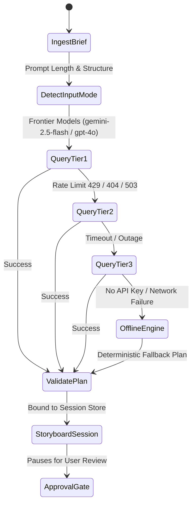

# Data Model: Dynamic AI Story Writer & Narrative Cascade

**Feature**: `specs/004-dynamic-story-writer`  
**Date**: 2026-10-23  
**Status**: Complete

---

## Domain Entities & Schemas

### 1. NarrativeBrief (Input Envelope)
Represents the creator's incoming creative concept or raw script text along with steering preferences.

```python
class NarrativeInputMode(str, Enum):
    CONCEPT_EXPANSION = "concept_expansion"  # Short prompt -> Multi-beat story
    SCRIPT_ADAPTATION = "script_adaptation"  # Full text -> Segmented scene beats

class VideoAspectRatio(str, Enum):
    VERTICAL_9_16 = "9:16"    # 1080x1920 (TikTok, Reels, Shorts) - Default
    WIDESCREEN_16_9 = "16:9"  # 1920x1080 (YouTube, Standard Displays)
    SQUARE_1_1 = "1:1"        # 1080x1080 (Instagram Square)
    PORTRAIT_4_5 = "4:5"      # 1080x1350 (Instagram Portrait Feed)

ASPECT_RATIO_RESOLUTIONS: Dict[VideoAspectRatio, Tuple[int, int]] = {
    VideoAspectRatio.VERTICAL_9_16: (1080, 1920),
    VideoAspectRatio.WIDESCREEN_16_9: (1920, 1080),
    VideoAspectRatio.SQUARE_1_1: (1080, 1080),
    VideoAspectRatio.PORTRAIT_4_5: (1080, 1350),
}

class NarrativeBrief(BaseModel):
    prompt_or_text: str = Field(min_length=1, description="Raw prompt or complete story text")
    input_mode: NarrativeInputMode = NarrativeInputMode.CONCEPT_EXPANSION
    aspect_ratio: VideoAspectRatio = VideoAspectRatio.VERTICAL_9_16
    width: int = Field(default=1080, description="Canvas width in pixels")
    height: int = Field(default=1920, description="Canvas height in pixels")
    genre_hint: Optional[Genre] = None
    target_duration_sec: Optional[float] = Field(default=None, ge=5.0, le=90.0)
    voice_persona: Optional[str] = "en-US-ChristopherNeural"
    reference_assets: Dict[str, ReferenceAsset] = Field(default_factory=dict)
```

---

### 2. ModelCascadeConfig (Orchestration Policy)
Defines the multi-tier cascade and timeout policies for model querying.

```python
class ModelProvider(str, Enum):
    GEMINI = "gemini"
    OPENAI = "openai"
    AUTO = "auto"
    OFFLINE = "offline"

class ModelCascadeConfig(BaseModel):
    provider: ModelProvider = ModelProvider.AUTO
    gemini_models: List[str] = Field(
        default_factory=lambda: [
            "gemini-2.5-flash",
            "gemini-2.5-pro",
            "gemini-2.0-flash",
            "gemini-1.5-flash",
            "gemini-1.5-pro"
        ]
    )
    openai_models: List[str] = Field(
        default_factory=lambda: [
            "gpt-4o",
            "gpt-4o-mini",
            "gpt-4-turbo"
        ]
    )
    timeout_sec: float = 8.0
    enable_offline_fallback: bool = True
```

---

### 3. StoryWriterResult (Execution Envelope)
Captures the synthesized `DirectorMasterPlan` along with cascade telemetry.

```python
class StoryWriterResult(BaseModel):
    plan: DirectorMasterPlan
    model_used: str
    tier_level: int = Field(description="1=Primary Frontier, 2=Secondary Stable, 3=Legacy, 4=Offline Local")
    latency_ms: float
    fallback_occurred: bool = False
    error_trace: List[str] = Field(default_factory=list)
```

---

## State Transition Diagram


