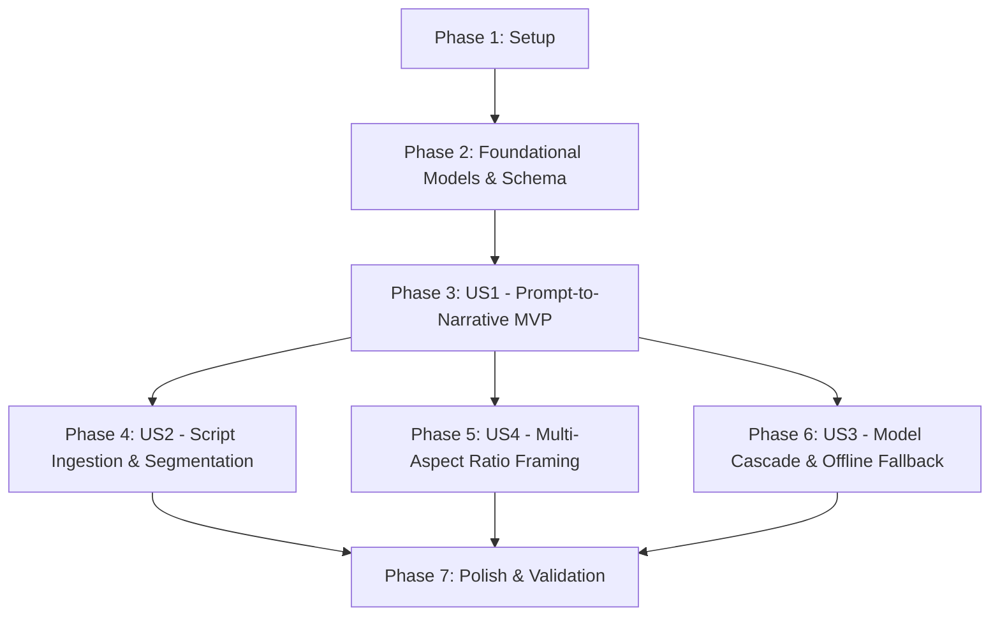

# Tasks: Dynamic AI Story Writer & Narrative Cascade

**Feature**: `specs/004-dynamic-story-writer`  
**Input**: [spec.md](file:///Users/ashishkumavat/Projects/ai-text-to-video/specs/004-dynamic-story-writer/spec.md), [plan.md](file:///Users/ashishkumavat/Projects/ai-text-to-video/specs/004-dynamic-story-writer/plan.md), [data-model.md](file:///Users/ashishkumavat/Projects/ai-text-to-video/specs/004-dynamic-story-writer/data-model.md), [research.md](file:///Users/ashishkumavat/Projects/ai-text-to-video/specs/004-dynamic-story-writer/research.md)  
**Status**: Completed

---

## Phase 1: Setup (Shared Infrastructure)

**Purpose**: Verify and prepare project dependencies, environment configuration, and test harnesses.

- [x] T001 Verify Google GenAI (`google-genai` / `google-generativeai`) and OpenAI SDK dependencies in `.venv/` via `requirements.txt`
- [x] T002 [P] Configure environment variable loading for `GEMINI_API_KEY` and `OPENAI_API_KEY` in `core/config.py`
- [x] T003 [P] Create initial test scaffold and mock fixtures for LLM responses in `tests/test_story_writer.py`

---

## Phase 2: Foundational (Blocking Prerequisites)

**Purpose**: Core data entities, aspect ratio definitions, and director plan schema extensions that MUST be complete before ANY user story can be implemented.

**⚠️ CRITICAL**: No user story work can begin until this phase is complete.

- [x] T004 Define `NarrativeInputMode`, `VideoAspectRatio`, and `ASPECT_RATIO_RESOLUTIONS` in `core/models.py`
- [x] T005 [P] Define `NarrativeBrief`, `ModelCascadeConfig`, and `StoryWriterResult` schemas in `core/models.py`
- [x] T006 [P] Extend `DirectorMasterPlan` and `VideoProject` with `aspect_ratio`, `width`, and `height` in `core/models.py`
- [x] T007 Validate domain model serialization and deserialization against `specs/004-dynamic-story-writer/contracts/story_writer_contract_schema.json` in `tests/test_story_writer.py`

**Checkpoint**: Foundation ready - all core entities and schema contracts validated. User story implementation can now begin.

---

## Phase 3: User Story 1 - Prompt-to-Narrative Dynamic Expansion (Priority: P1) 🎯 MVP

**Goal**: Transform arbitrary creative concept prompts into authentic, dynamic multi-scene stories with custom dialogue, cinematic visual descriptions, and sound cues instead of static templates.

**Independent Test**: Run story generation with prompt *"A clumsy time-traveling barista accidentally serves coffee to Napoleon"*. Verify the plan contains 2 to 5 dynamic scene beats with bespoke dialogue, matching sound effects, and zero template placeholders.

### Tests for User Story 1

- [x] T008 [P] [US1] Unit test for dynamic prompt-to-story synthesis and schema validation in `tests/test_story_writer.py`
- [x] T009 [P] [US1] Integration test for dynamic prompt expansion through interactive director in `tests/test_interactive_director.py`

### Implementation for User Story 1

- [x] T010 [US1] Implement `StoryWriterGateway` skeleton and system prompt engineering in `core/story_writer.py`
- [x] T011 [US1] Implement structured JSON generation using Gemini SDK (`response_mime_type="application/json"`) in `core/story_writer.py`
- [x] T012 [US1] Connect `InteractiveDirector.create_storyboard()` to invoke `StoryWriterGateway` in `core/interactive_director.py`
- [x] T013 [US1] Wire CLI `--prompt` flag to dynamic story generator with formatted terminal preview in `core/cli.py`

**Checkpoint**: User Story 1 is functional as an MVP! Creators can input arbitrary prompts and receive tailored multi-beat stories ready for review.

---

## Phase 4: User Story 2 - Full Script & Long-Form Text Ingestion (Priority: P2)

**Goal**: Ingest multi-paragraph articles, fables, or pre-written scripts and automatically segment them into sequential scene beats while preserving 100% of the author's original dialogue.

**Independent Test**: Submit a 3-paragraph story script. Verify the partitioned beats retain the author's exact spoken words across scenes without truncation or invented dialogue.

### Tests for User Story 2

- [x] T014 [P] [US2] Unit test for script text segmentation and dialogue preservation in `tests/test_story_writer.py`
- [x] T015 [P] [US2] Integration test for multi-scene script ingestion through CLI in `tests/integration/test_dynamic_story_flow.py`

### Implementation for User Story 2

- [x] T016 [US2] Implement script partitioning and spoken dialogue extraction in `core/story_writer.py`
- [x] T017 [US2] Add pacing and timing constraints (3s to 8s per beat, max 6 scenes) for long-form scripts in `core/story_writer.py`
- [x] T018 [US2] Expose `--input-mode` (`concept_expansion` vs `script_adaptation`) and file input handling in `core/cli.py`

**Checkpoint**: User Story 2 complete! Users can supply existing scripts or long text and receive segmented storyboard scenes preserving exact dialogue.

---

## Phase 5: User Story 4 - Multi-Aspect Ratio Framing & Canvas Adaptation (Priority: P2)

**Goal**: Support configurable video aspect ratios (`9:16`, `16:9`, `1:1`, `4:5`), tailor visual composition prompts for target framing, and render master video at the exact canvas resolution without pillarboxing or distortion.

**Independent Test**: Execute `python -m core.cli direct --prompt "A space freighter docking at Saturn" --aspect-ratio 16:9 --auto-approve`. Verify widescreen composition tokens in prompts, 1920x1080 keyframe synthesis, and 1920x1080 master MP4 compilation.

### Tests for User Story 4

- [x] T019 [P] [US4] Unit test for aspect-ratio prompt phrasing adaptation (`9:16`, `16:9`, `1:1`, `4:5`) in `tests/test_story_writer.py`
- [x] T020 [P] [US4] Integration test for dynamic resolution passing to Remotion bridge in `tests/integration/test_dynamic_story_flow.py`

### Implementation for User Story 4

- [x] T021 [US4] Implement aspect-ratio-aware visual prompt stylizer (framing, blocking, camera motion) in `core/story_writer.py`
- [x] T022 [US4] Propagate target `width` and `height` through `DirectorMasterPlan` and `VideoProject` in `core/interactive_director.py`
- [x] T023 [US4] Update `core/remotion_bridge.py` to forward dynamic canvas resolution to Remotion props and render command
- [x] T024 [US4] Add `--aspect-ratio` option with choices (`9:16`, `16:9`, `1:1`, `4:5`) in `core/cli.py`

**Checkpoint**: User Story 4 complete! Creators can seamlessly generate horizontal widescreen (16:9 YouTube), vertical mobile (9:16 Shorts/TikTok), square (1:1), and portrait (4:5) videos.

---

## Phase 6: User Story 3 - Multi-Tier Model Cascade & Resilient Offline Fallback (Priority: P3)

**Goal**: Automatically attempt the newest frontier models first (`gemini-2.5-flash`/`gemini-2.5-pro` or `gpt-4o`), cascade down to stable high-throughput tiers upon 429/quota errors, and fall back to a local deterministic rule engine when unauthenticated.

**Independent Test**: Unset `GEMINI_API_KEY` and `OPENAI_API_KEY` and run `direct`. Verify system automatically activates Tier 4 offline fallback, synthesizing a valid storyboard plan with 0 crashes.

### Tests for User Story 3

- [x] T025 [P] [US3] Unit test for model cascade failover upon simulated 429 quota exceptions in `tests/test_story_writer.py`
- [x] T026 [P] [US3] Unit test for offline deterministic fallback when API keys are absent in `tests/test_story_writer.py`

### Implementation for User Story 3

- [x] T027 [US3] Implement `ModelCascadeManager` with ordered fallback policy in `core/story_writer.py`
- [x] T028 [US3] Implement OpenAI provider client and fallbacks in `core/story_writer.py`
- [x] T029 [US3] Implement deterministic local rule-engine fallback adapter in `core/story_writer.py`
- [x] T030 [US3] Expose `--model` override and cascade telemetry logging in `core/cli.py`

**Checkpoint**: User Story 3 complete! Zero-crash resilience guaranteed across API outages, quota depletion, and offline local development.

---

## Phase 7: Polish & Cross-Cutting Concerns

**Purpose**: End-to-end integration verification, regression testing, and validation against all quickstart scenarios.

- [x] T031 [P] Run full test suite with `pytest tests/` and verify 100% pass rate
- [x] T032 Validate all 5 scenarios in `specs/004-dynamic-story-writer/quickstart.md`
- [x] T033 [P] Update `README.md` and docs with dynamic story writing and aspect ratio CLI options

---

## Dependencies & Execution Order

### Phase Dependencies

- **Setup (Phase 1)**: No dependencies - can start immediately.
- **Foundational (Phase 2)**: Depends on Setup (Phase 1) - **BLOCKS all user stories**.
- **User Story 1 (Phase 3 - P1 MVP)**: Depends on Foundational (Phase 2).
- **User Story 2 (Phase 4 - P2)**: Depends on Foundational (Phase 2) and US1 core gateway.
- **User Story 4 (Phase 5 - P2)**: Depends on Foundational (Phase 2) and US1 core gateway. Can be implemented in parallel with US2.
- **User Story 3 (Phase 6 - P3)**: Depends on US1 core gateway.
- **Polish (Phase 7)**: Depends on all user stories being complete.

---

## Parallel Execution Opportunities

- **Phase 1**: T002 and T003 can execute in parallel.
- **Phase 2**: T005 and T006 can execute in parallel once T004 is defined.
- **Phase 3 (US1)**: Tests T008 and T009 can be written concurrently.
- **Phase 4 (US2) & Phase 5 (US4)**: Can be implemented concurrently after US1 baseline is in place.
- **Phase 6 (US3)**: Tests T025 and T026 can be written concurrently.

---

## Implementation Strategy

### MVP First (User Story 1 Only)
1. Complete Phase 1: Setup
2. Complete Phase 2: Foundational (Entities & Schema Contracts)
3. Complete Phase 3: User Story 1 (Prompt ➔ Dynamic Narrative Plan)
4. **STOP and VALIDATE**: Verify prompt expansion with `pytest tests/test_story_writer.py` and run manual direct test.

### Incremental Delivery
1. Add User Story 2: Script Adaptation & Dialogue Preservation
2. Add User Story 4: Multi-Aspect Ratio Support (`16:9`, `9:16`, `1:1`, `4:5`)
3. Add User Story 3: Multi-Tier Model Cascade & Offline Resilience
4. Phase 7: Polish, full test suite pass, and quickstart scenario verification.
