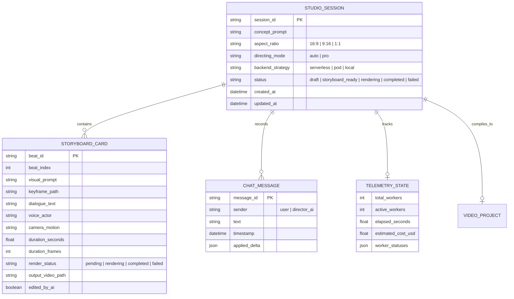

# Data Model: 006 Web Studio Interface & AI Director Copilot

**Feature**: `specs/006-web-studio-interface/spec.md`  
**Date**: 2026-10-24  
**Status**: Completed  

---

## Domain Entities & Schema Definitions

---

### 1. `StudioSession` (Core Workspace State)
Represents the active video creation project in the Web Studio.

| Field | Type | Required | Description |
|---|---|---|---|
| `session_id` | `str` (UUID) | Yes | Unique identifier for the studio session. |
| `concept_prompt` | `str` | Yes | The high-level user idea or script concept. |
| `aspect_ratio` | `str` | Yes | Target framing: `"16:9"` (default), `"9:16"`, or `"1:1"`. |
| `directing_mode` | `str` | Yes | `"auto"` (1-click direct synthesis) or `"pro"` (approval gate). |
| `backend_strategy` | `str` | Yes | `"serverless"` (default), `"pod"`, or `"local"`. |
| `beats` | `List[StoryboardCard]` | Yes | Ordered array of narrative beat cards. |
| `chat_history` | `List[ChatMessage]` | Yes | Conversation thread with Gemini AI Co-Director. |
| `telemetry` | `Optional[TelemetryState]` | No | Real-time GPU cloud compute state. |
| `master_video_path` | `Optional[str]` | No | Local filesystem path to the rendered 1080p MP4. |
| `status` | `str` | Yes | Session lifecycle state: `draft`, `storyboard_ready`, `rendering`, `completed`, `failed`. |

---

### 2. `StoryboardCard` (Narrative Scene Beat)
Represents an individual scene card rendered on the Visual Canvas.

| Field | Type | Required | Description |
|---|---|---|---|
| `beat_id` | `str` | Yes | Unique card identifier (e.g., `"beat_1"`). |
| `beat_index` | `int` | Yes | 0-indexed sequence position. |
| `visual_prompt` | `str` | Yes | Diffusion prompt describing lighting, action, and subject. |
| `keyframe_path` | `Optional[str]` | No | Local URL / path to the approved starting keyframe image. |
| `dialogue_text` | `str` | Yes | Spoken voiceover narration for this beat. |
| `voice_actor` | `str` | Yes | Selected Edge-TTS voice identifier (e.g., `"en-US-ChristopherNeural"`). |
| `camera_motion` | `str` | Yes | Camera movement: `"push_in"`, `"pan_right"`, `"drone_rise"`, `"static"`. |
| `duration_seconds` | `float` | Yes | Time length of the shot in seconds. |
| `duration_frames` | `int` | Yes | Time length in frames (e.g. 17, 33, 49 at 16 FPS). |
| `render_status` | `str` | Yes | `"pending"`, `"in_queue"`, `"rendering"`, `"completed"`, `"failed"`. |
| `output_video_path`| `Optional[str]` | No | Rendered MP4 clip path once diffused. |
| `edited_by_ai` | `bool` | No | Flag indicating if this card was modified by AI chat. |

---

### 3. `ChatMessage` & `CoDirectorDelta`
Represents messages in the interactive AI Co-Director Chat sidebar.

| Field | Type | Required | Description |
|---|---|---|---|
| `message_id` | `str` | Yes | Unique message ID. |
| `sender` | `str` | Yes | `"user"` or `"director_ai"`. |
| `text` | `str` | Yes | Conversational message content displayed to the user. |
| `timestamp` | `datetime`| Yes | ISO-8601 creation time. |
| `applied_delta` | `Optional[dict]` | No | JSON structured action executed on the storyboard (e.g. `{"action": "UPDATE_BEAT", "beat_index": 1, "field": "visual_prompt", "value": "..."}`). |

---

### 4. `TelemetryState` (Live Cloud Worker Grid)
Represents the real-time compute and financial meter displayed in the studio header and footer.

| Field | Type | Required | Description |
|---|---|---|---|
| `total_workers` | `int` | Yes | Configured concurrency limit (default 4). |
| `active_workers` | `int` | Yes | Number of GPU workers actively diffusing frames. |
| `elapsed_seconds`| `float` | Yes | Total wall-clock time elapsed for the current render. |
| `estimated_cost_usd` | `float` | Yes | Running aggregate billing in USD ($\text{Seconds} \times \$0.00021$). |
| `worker_details` | `List[dict]` | Yes | Array of worker tiles: `{"worker_id": str, "status": str, "beat_index": int, "elapsed_s": float}`. |
