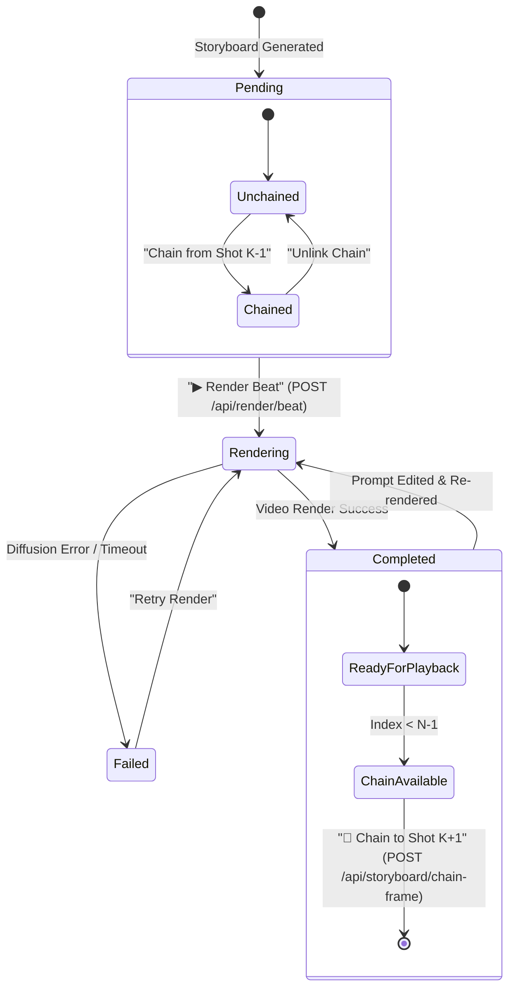

# Data Model: Iterative Shot Chaining & Single-Beat Rendering in Pro Director

**Feature Branch**: `008-iterative-shot-chaining`  
**Date**: 2026-10-25  
**Spec**: [specs/008-iterative-shot-chaining/spec.md](file:///Users/ashishkumavat/Projects/ai-text-to-video/specs/008-iterative-shot-chaining/spec.md)

---

## 1. Entity Definitions & Schemas

### 1.1 StoryboardCard (Frontend & Studio Canvas Model)
Represents a single narrative beat card rendered in the Pro Director canvas. Extended with continuity tracking fields.

| Field | Type | Required | Default | Description |
|---|---|---|---|---|
| `beat_id` | `string` | Yes | `uuid4()` | Unique identifier for the beat card. |
| `beat_index` | `int` | Yes | - | 0-based sequential shot order (0, 1, 2, ...). |
| `visual_prompt` | `string` | Yes | - | Detailed image/video diffusion prompt. |
| `keyframe_path` | `string \| null` | No | `null` | URL path (`/outputs/...`) to the preview keyframe image plate. |
| `speaker` | `string` | Yes | `"Narrator"` | Character name attributed to dialogue line. |
| `dialogue_text` | `string` | Yes | `""` | Spoken narrative line. |
| `voice_actor` | `string` | Yes | `"auto"` | TTS voice persona identifier. |
| `camera_motion` | `string` | Yes | `"push_in"` | Kinetic camera movement instruction. |
| `duration_seconds` | `float` | Yes | `3.0` | Target clip duration in seconds. |
| `duration_frames` | `int` | Yes | `49` | Frame count calculated as `duration_seconds * 16`. |
| `render_status` | `enum` | Yes | `"pending"` | Status: `"pending"` \| `"in_queue"` \| `"rendering"` \| `"completed"` \| `"failed"`. |
| `output_video_path` | `string \| null` | No | `null` | URL path (`/outputs/...`) to the generated H.264 MP4 clip. |
| `edited_by_ai` | `boolean` | No | `false` | True if modified by Gemini Co-Director chat. |
| `is_custom_image` | `boolean` | No | `false` | True if user manually uploaded a custom plate. |
| `is_chained` | `boolean` | No | `false` | **NEW**: True if this beat uses the final frame of the preceding shot as starting anchor. |
| `chained_from_beat` | `int \| null` | No | `null` | **NEW**: 0-based beat index of the source shot providing the starting anchor. |
| `chain_out_of_sync` | `boolean` | No | `false` | **NEW**: True if upstream source shot was re-rendered, leaving this chain out of date. |
| `error_message` | `string \| null` | No | `null` | Diagnostic error string if `render_status == "failed"`. |

---

### 1.2 ContinuityLink (Backend Scene Plan Model)
Represents physical frame handoff metadata embedded inside `StoryboardBeat` and `SceneBeatPlan`.

| Field | Type | Required | Default | Description |
|---|---|---|---|---|
| `chain_from_previous` | `bool` | Yes | `False` | Whether video diffusion must condition on Frame -1 of previous shot. |
| `previous_beat_id` | `Optional[str]` | No | `None` | UUID or identifier of the source beat. |
| `extracted_tail_frame_path` | `Optional[str]` | No | `None` | Absolute filesystem path to the extracted Frame -1 PNG. |
| `motion_continuation_prompt` | `Optional[str]` | No | `None` | Optional directional prompt guiding camera continuation across cut. |

---

### 1.3 Request & Response DTOs

#### RenderBeatRequest
Payload sent when a creator triggers single-beat rendering on a specific card.
```json
{
  "session_id": "c8769d67-083a-4d60-9d20-4d6aeb7bd384",
  "beat_index": 0,
  "backend": "serverless"
}
```

#### ChainFrameRequest
Payload sent when a creator binds the terminal frame of Shot $K$ to Shot $K+1$.
```json
{
  "session_id": "c8769d67-083a-4d60-9d20-4d6aeb7bd384",
  "source_beat_index": 0
}
```

#### UnlinkChainRequest
Payload sent when a creator decouples a chained beat back to an independent keyframe.
```json
{
  "session_id": "c8769d67-083a-4d60-9d20-4d6aeb7bd384",
  "beat_index": 1
}
```

#### CompileMasterRequest
Payload sent when a creator triggers final assembly of pre-rendered clips into the master video.
```json
{
  "session_id": "c8769d67-083a-4d60-9d20-4d6aeb7bd384",
  "allow_partial": false
}
```

---

## 2. State Machine & Transitions



### 2.1 Upstream Re-render Invalidation Flow
When Shot $K$ is re-rendered:
1. Target Shot $K+1$ has `is_chained == true` and `chained_from_beat == K`.
2. Once Shot $K$ finishes new video generation, the backend checks if Shot $K+1$ is chained to $K$.
3. If chained, Shot $K+1$ sets `chain_out_of_sync = true`.
4. In the studio UI, Shot $K+1$ displays an amber badge: `⚠️ Upstream Re-rendered: [Update Chained Frame]`.
5. Clicking `Update Chained Frame` re-runs `POST /api/storyboard/chain-frame` with the new Shot $K$ video, re-extracts Frame -1, and clears `chain_out_of_sync`.

---

## 3. Storage & Persistence Layout

All artifacts are persisted under `outputs/temp/`:
- **Chained Frames**: `outputs/temp/chain_{session_id[:8]}_shot_{K}_to_{K+1}.png`
- **Rendered Beat Clips**: `outputs/temp/{session_id}/beat_{K}.mp4` (or `outputs/temp/scene_{K}_{session_id[:8]}.mp4`)
- **Master Video Export**: `outputs/temp/{session_id}_master.mp4`
- **Session State**: `outputs/temp/sessions/{session_id}.json` with updated `StoryboardSession` and `StoryboardCard` records.
