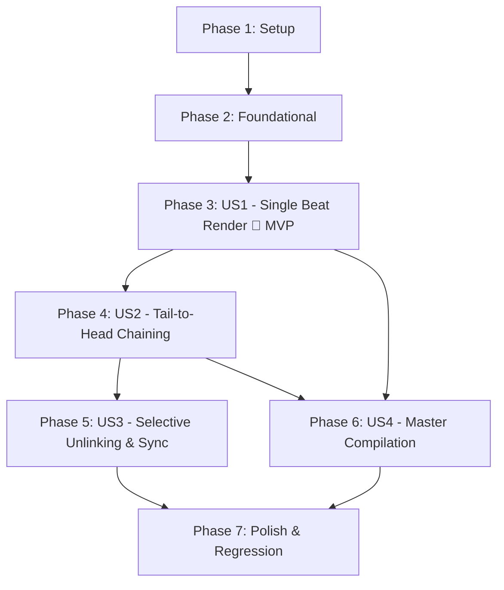

# Tasks: Iterative Shot Chaining & Single-Beat Rendering in Pro Director

**Feature Branch**: `008-iterative-shot-chaining`  
**Date**: 2026-10-25  
**Spec**: [specs/008-iterative-shot-chaining/spec.md](file:///Users/ashishkumavat/Projects/ai-text-to-video/specs/008-iterative-shot-chaining/spec.md)  
**Plan**: [specs/008-iterative-shot-chaining/plan.md](file:///Users/ashishkumavat/Projects/ai-text-to-video/specs/008-iterative-shot-chaining/plan.md)  
**Data Model**: [specs/008-iterative-shot-chaining/data-model.md](file:///Users/ashishkumavat/Projects/ai-text-to-video/specs/008-iterative-shot-chaining/data-model.md)  
**Contracts**: [specs/008-iterative-shot-chaining/contracts/chaining_api.json](file:///Users/ashishkumavat/Projects/ai-text-to-video/specs/008-iterative-shot-chaining/contracts/chaining_api.json)

---

## Phase 1: Setup (Shared Infrastructure)

**Purpose**: Test scaffolding, environment verification, and directory setup.

- [X] T001 [P] Verify environment dependencies and directory layout in outputs/temp/ and studio/
- [X] T002 [P] Create test fixture and scaffolding for single-beat and chaining validation in tests/test_iterative_chaining.py

---

## Phase 2: Foundational (Blocking Prerequisites)

**Purpose**: Core data models, DTOs, and interface types that MUST be complete before user stories can be implemented.

**⚠️ CRITICAL**: No user story implementation can begin until this foundational phase is complete.

- [X] T003 [P] Extend StoryboardCard schema with continuity fields (is_chained, chained_from_beat, chain_out_of_sync) in core/models.py
- [X] T004 [P] Update StoryboardCard TypeScript interface and API client DTOs in studio/src/services/api.ts
- [X] T005 Add request DTOs (RenderBeatRequest, ChainFrameRequest, UnlinkChainRequest, CompileMasterRequest) in core/server.py

**Checkpoint**: Foundation ready — user story implementation can now begin.

---

## Phase 3: User Story 1 - Single-Beat Video Synthesis (Priority: P1) 🎯 MVP

**Goal**: Creators can trigger video diffusion for a single narrative beat card without triggering batch rendering of any other scene beats.

**Independent Test**: Plan a 3-beat storyboard, trigger `POST /api/render/beat` on Shot 1, verify only Shot 1 renders to MP4 and displays in inline player while Shots 2 and 3 remain pending.

### Tests for User Story 1

- [X] T006 [P] [US1] Unit test for single-beat backend execution and status persistence in tests/test_iterative_chaining.py

### Implementation for User Story 1

- [X] T007 [US1] Implement single-beat video execution endpoint POST /api/render/beat supporting serverless, pod, and local mock in core/server.py
- [X] T008 [US1] Add renderBeat API client method in studio/src/services/api.ts
- [X] T009 [US1] Add 'Render Beat' button, progress spinner, and inline video playback to BeatCard in studio/src/components/BeatCard.tsx
- [X] T010 [US1] Connect BeatCard single-beat render handlers and state updates in studio/src/App.tsx

**Checkpoint**: At this point, User Story 1 is fully functional and delivers an independent MVP for single-beat rendering.

---

## Phase 4: User Story 2 - Tail-to-Head Frame Chaining Across Consecutive Shots (Priority: P1)

**Goal**: Extract Frame -1 from completed Shot K using OpenCV and bind it as START_FRAME and keyframe preview of Shot K+1 for 100% optical continuity.

**Independent Test**: Render Shot 1, trigger `POST /api/storyboard/chain-frame` for Shot 1, verify Shot 2's keyframe updates to Frame -1 PNG, displays "Chained from Shot 1" badge, and renders Shot 2 using that image as start frame.

### Tests for User Story 2

- [X] T011 [P] [US2] Unit test for OpenCV Frame -1 extraction and target beat START_FRAME binding in tests/test_iterative_chaining.py

### Implementation for User Story 2

- [X] T012 [US2] Implement POST /api/storyboard/chain-frame endpoint using extract_terminal_frame in core/server.py
- [X] T013 [US2] Add chainFrameToNextShot API client method in studio/src/services/api.ts
- [X] T014 [US2] Add 'Chain to Next Shot' action button and 'Chained from Shot K' continuity badge in studio/src/components/BeatCard.tsx
- [X] T015 [US2] Connect chainFrame handler in studio/src/App.tsx to update canvas cards and persist session state

**Checkpoint**: User Stories 1 and 2 operate seamlessly together, enabling iterative render-then-chain workflows.

---

## Phase 5: User Story 3 - Selective Unlinking & Chain Overrides (Priority: P2)

**Goal**: Allow creators to unlink a chained frame, replace it with custom artwork or prompt re-roll, and detect upstream re-render out-of-sync states.

**Independent Test**: Chain Shot 1 to Shot 2, trigger `POST /api/storyboard/unlink-chain`, verify Shot 2 reverts to independent keyframe plate and removes continuity badge; re-render Shot 1 and verify Shot 2 displays out-of-sync alert.

### Tests for User Story 3

- [X] T016 [P] [US3] Unit test for chain unlinking and upstream re-render invalidation in tests/test_iterative_chaining.py

### Implementation for User Story 3

- [X] T017 [US3] Implement POST /api/storyboard/unlink-chain endpoint and upstream invalidation check in core/server.py
- [X] T018 [US3] Add unlinkChain API client method in studio/src/services/api.ts
- [X] T019 [US3] Add 'Unlink Chain' action button and 'Upstream Re-rendered' sync alert in studio/src/components/BeatCard.tsx
- [X] T020 [US3] Connect unlink and re-chain handlers in studio/src/App.tsx

**Checkpoint**: Creators have full artistic control to unlink, override, or re-synchronize continuity links.

---

## Phase 6: User Story 4 - Master Video Compilation from Individually Rendered Clips (Priority: P1)

**Goal**: Stitch all pre-rendered scene clips into a master 1080p video with synthesized character voices, background music, audio ducking, and kinetic subtitles in < 15 seconds.

**Independent Test**: Render all beats individually, trigger `POST /api/render/compile`, verify master MP4 is generated with synced multi-character dialogue, SFX, and kinetic subtitles without re-rendering video diffusion clips.

### Tests for User Story 4

- [X] T021 [P] [US4] Integration test for compiling master timeline from pre-rendered clips in tests/test_iterative_chaining.py

### Implementation for User Story 4

- [X] T022 [US4] Implement POST /api/render/compile skipping video diffusion and invoking audio + Remotion composition in core/server.py
- [X] T023 [US4] Add compileMasterVideo API client method in studio/src/services/api.ts
- [X] T024 [US4] Add 'Compile Master Video' action button in studio/src/components/DirectorSidebar.tsx
- [X] T025 [US4] Connect compile master handler and live studio player preview in studio/src/App.tsx

**Checkpoint**: All 4 user stories complete the end-to-end production loop from single-beat iteration to master export.

---

## Phase 7: Polish & Cross-Cutting Concerns

**Purpose**: Styling enhancements, persistence fidelity across reloads, and end-to-end regression validation.

- [X] T026 [P] Add CSS styling for continuity badges, chaining connection indicators, and out-of-sync alerts in studio/src/styles/studio.css
- [X] T027 [P] Update session serialization and restoration to persist chaining metadata in core/interactive_director.py
- [X] T028 Execute full quickstart validation scenarios and test suite with ./.venv/bin/pytest tests/test_iterative_chaining.py

---

## Dependencies & Execution Order

### Phase Dependencies



### User Story Dependencies

* **User Story 1 (P1 - MVP)**: Can start immediately once Phase 2 (Foundational) is complete. Has no dependencies on any other story.
* **User Story 2 (P1 - Chaining)**: Depends on US1's capability to render a clip to MP4 so that Frame -1 exists to be extracted.
* **User Story 3 (P2 - Unlinking & Invalidation)**: Depends on US2's chaining data model and endpoints.
* **User Story 4 (P1 - Compilation)**: Depends on US1 (rendered clips existing on disk); integrates with US2/US3 chained outputs.

---

## Parallel Opportunities

```bash
# Phase 1 Setup (run in parallel):
Task T001: Environment dependencies in outputs/temp/ and studio/
Task T002: Test scaffolding in tests/test_iterative_chaining.py

# Phase 2 Foundational (run in parallel):
Task T003: StoryboardCard schema in core/models.py
Task T004: StoryboardCard TypeScript types in studio/src/services/api.ts

# Phase 3 User Story 1 (parallel backend & frontend models/tests):
Task T006: Backend test in tests/test_iterative_chaining.py
Task T008: API client in studio/src/services/api.ts
Task T009: BeatCard component in studio/src/components/BeatCard.tsx
```

---

## Implementation Strategy

### MVP First (User Story 1 Only)
1. Complete Phase 1 (Setup) and Phase 2 (Foundational).
2. Complete Phase 3 (User Story 1: Single-Beat Video Synthesis).
3. **Validate**: Click "Render Beat" on Shot 1. Verify Shot 1 generates and displays inline in the Studio player without triggering Shots 2 or 3.

### Incremental Delivery
1. **Increment 1 (MVP)**: Single-beat render isolation.
2. **Increment 2**: Frame -1 OpenCV extraction and optical chaining from Shot $K$ to Shot $K+1$.
3. **Increment 3**: Unlink and re-sync alert handling.
4. **Increment 4**: Instant master video compilation from pre-rendered clips.
5. **Increment 5**: Full regression validation and visual polish.
